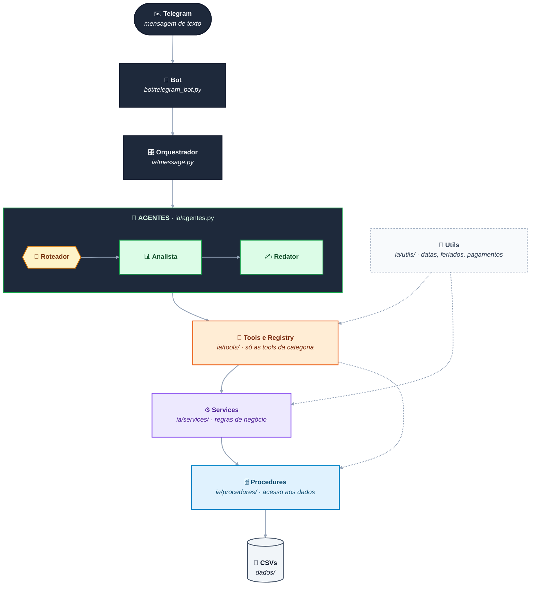
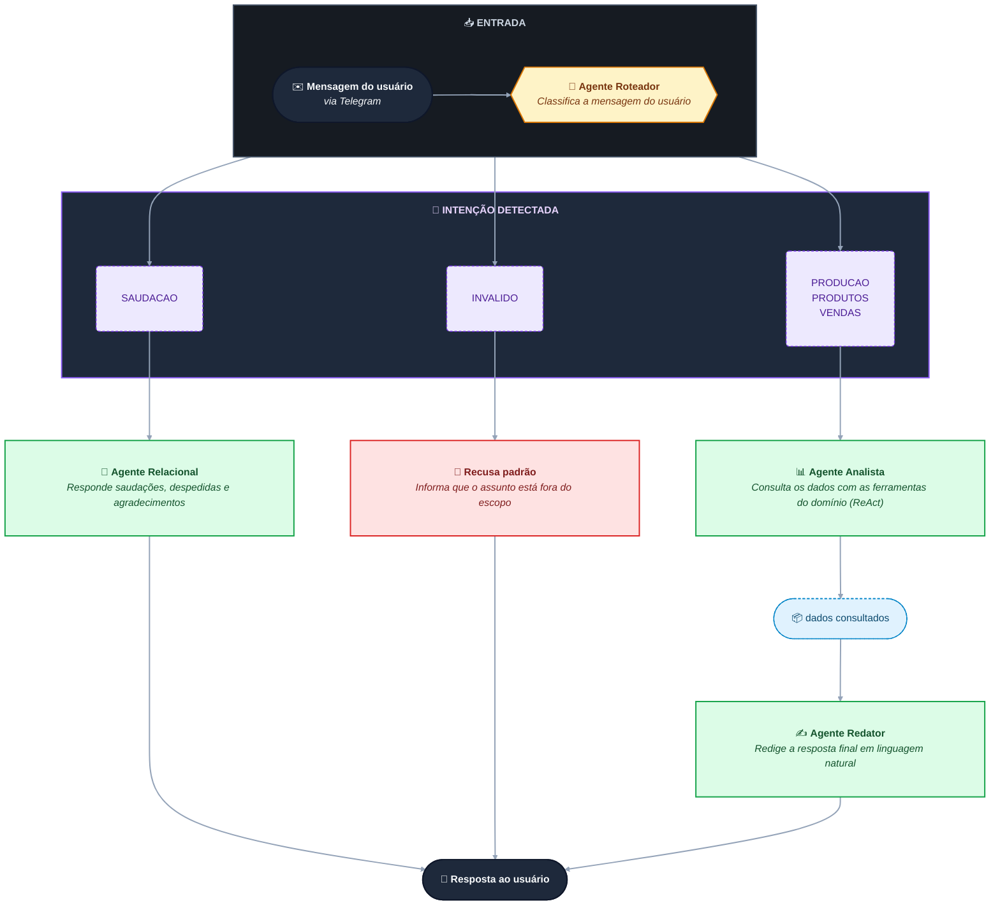
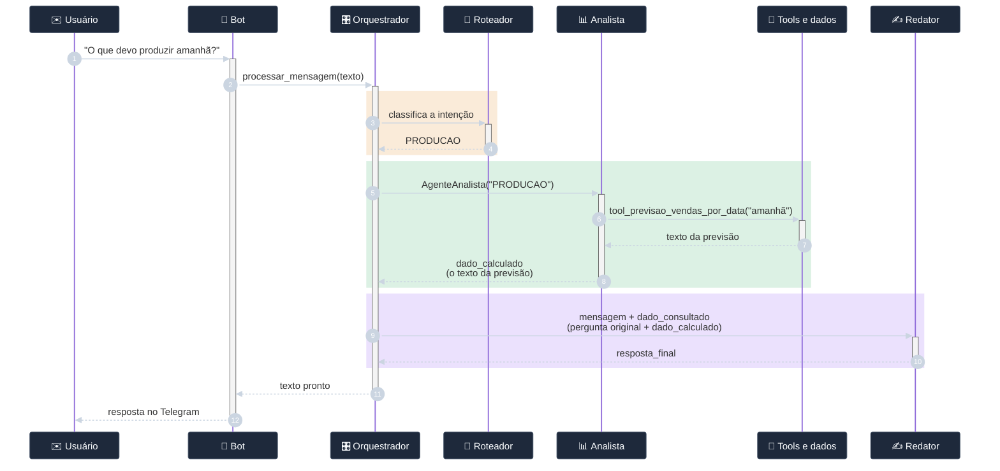

# 🧠 Arquitetura — MIA - Assistente de Análise de Dados

## Sumário
- [Visão geral das camadas](#visao-geral)
- [1. Utilitários (`ia/utils/`)](#utils)
- [2. Motor de Dados: Procedures (`ia/procedures/`)](#procedures)
- [3. Regras de Negócio: Services (`ia/services/`)](#services)
- [4. Ferramentas da IA: Tools e Registry (`ia/tools/`)](#tools)
- [5. Agentes de IA e Fluxo de Mensagens](#agentes)

---

## Visão geral das camadas <a id="visao-geral"></a>

O backend separa estritamente as responsabilidades, com roteamento dinâmico de contexto para otimizar o uso da GPU local:

- **Utils** → funções puras de apoio: datas relativas, feriados, dias de pagamento e normalização de setor.
- **Procedures** → acesso aos dados, com Pandas. Não sabe nada sobre IA.
- **Services** → regras de negócio (ex.: previsão de produção). Combinam procedures e utils.
- **Tools e Registry** → interfaces semânticas categorizadas que a IA consegue chamar. Usam services, procedures e utils.
- **Agentes** → roteamento da intenção, execução ReAct sob demanda e redação da resposta.
- **Bot** → entrada pelo Telegram (apenas texto).



*Linhas pontilhadas: as tools de `PRODUTOS` consultam as procedures diretamente, e os utils dão apoio às tools e aos services.*

### Estrutura de pastas

```text
backend/
├── dados/ ## Banco de dados CSV
│   ├── descarte/                   ## Histórico de quebras mensais
│   ├── regras/                     ## Sazonalidade, clima e feriados
│   ├── vendas/                     ## Volume histórico de vendas
│   ├── historico_ingredientes.csv
│   ├── historico_produtos.csv
│   ├── ingredientes.csv            ## Estoque atual setorizado
│   ├── produtos.csv                ## Catálogo e preços
│   └── receitas.csv                ## Ficha técnica (BOM)
└── src/
    ├── .env                        ## Variáveis (TELEGRAM_BOT_KEY)
    ├── .env.example
    ├── main.py                     ## Ponto de entrada e inicialização
    ├── paths.py                    ## Gestão dinâmica de diretórios
    ├── bot/
    │   └── telegram_bot.py         ## Recepção de mensagens de texto
    └── ia/
        ├──  message.py             ## Orquestrador e roteamento
        ├──  agentes.py             ## Signatures e Agentes DSPy
        ├──  config.py              ## Setup do Ollama e LLM local
        ├──  procedures/            ## Queries diretas ao Pandas (Data Access)
        │   ├── descarte_procedures.py
        │   ├── ingredientes_procedures.py
        │   ├── produtos_procedures.py
        │   ├── regras_procedures.py
        │   └── vendas_procedures.py
        ├── services/               ## Lógica de negócio (Domain)
        │   └── producao_service.py
        ├── tools/                  ## Ferramentas expostas ao Agente
        │   ├── producao_tool.py
        │   └── produtos_tools.py
        └── utils/                  ## Funções de apoio
            ├── datas_utils.py
            ├── feriados_utils.py
            ├── pagamentos_utils.py
            └── textos_utils.py
```

---

## 1. Utilitários (`ia/utils/`) <a id="utils"></a>

Funções de apoio, expostas pelo `__init__.py` e usadas assim: `from ia import utils`. São usadas pelas *tools* e pelos *services*.

```python
from ia import utils

utils.converter_data_relativa('10/10/2026')
utils.normalizar_setor('padaira') # para corrigir o erro ortográfico
```

| Módulo             | Função                                                  | O que faz                                                                                                                                                                                                                                                 |
| ------------------ | ------------------------------------------------------- | --------------------------------------------------------------------------------------------------------------------------------------------------------------------------------------------------------------------------------------------------------- |
| `datas_utils`      | `converter_data_relativa(data_alvo: str) -> str`        | Converte hoje/hj, amanhã/amanha, ontem, anteontem, "N dias atrás", "há N dias" e "daqui a N dias" para DD/MM/AAAA. Se não reconhecer o texto, devolve o original.                                                                                         |
| `textos_utils`     | `normalizar_setor(setor_informado: str) -> str \| None` | Corretor ortográfico e mapeador de apelidos de setor (ex: `"cozinha"` → `"Cozinha/Rotisseria"`). Setores oficiais: Açougue, Padaria, Cozinha/Rotisseria, Peixaria e Confeitaria.                                                                          |
| `feriados_utils`   | `eh_feriado(data) -> bool`                              | Verifica feriados fixos (nacionais, SP e municipais) e móveis (Carnaval, Sexta-Feira Santa e Corpus Christi, calculados a partir da Páscoa). O 20/11 só conta a partir de 2024.                                                                           |
| `pagamentos_utils` | `dias_ate_pagamento(valor: str) -> int`                 | Calcula a distância até o pagamento (dia 20, antecipado para o dia 19 se cair no domingo, ou 5º dia útil; sábado é útil e feriado não). `0` é o próprio dia, negativo é pagamento no futuro, positivo é no passado, e `-999` é sem pagamento em ±20 dias. |
| `pagamentos_utils` | `classificar_dia(data: str) -> int`                     | Devolve `1` (dia de pico) ou `0` (dia comum). É pico se for dia de pagamento, sexta a domingo ou feriado. Resultado em cache (`lru_cache`).                                                                                                               |

---

## 2. Motor de Dados: Procedures (`ia/procedures/`) <a id="procedures"></a>

Todo acesso é feito através do `__init__.py`, que expõe cada arquivo como um "apelido":

```python
from ia import procedures

procedures.vendas.buscar_por_nome_produto("coxinha")
procedures.produtos.buscar_por_setor("Padaria")
```

Os CSVs são lidos uma única vez, ao importar o módulo, e ficam em memória.

| Apelido        | Arquivo                      | Fonte de dados                  | O que oferece                                                                                                                                                                                                                 |
| -------------- | ---------------------------- | ------------------------------- | ----------------------------------------------------------------------------------------------------------------------------------------------------------------------------------------------------------------------------- |
| `produtos`     | `produtos_procedures.py`     | `dados/produtos.csv`            | Catálogo: `listar`, `listar_detalhado`, `buscar_por_nome`, `buscar_por_setor` (com fallback que separa o setor em partes), `buscar_por_tempo`, `obter_dicionario_sku_nome`, `nome_do_sku`, `skus_por_nome`, `skus_por_setor`. |
| `vendas`       | `vendas_procedures.py`       | `dados/vendas/vendas_*.csv`     | `todas_as_vendas`, `buscar_por_data`, `buscar_por_periodo`, `buscar_por_nome_produto`, `produtos_mais_vendidos`.                                                                                                              |
| `descarte`     | `descarte_procedures.py`     | `dados/descarte/descarte_*.csv` | Consultas e somas de desperdício: por produto, por data, por produto e dia, total, média diária, top 5, maior/menor dia e produtos acima de um limite.                                                                        |
| `regras`       | `regras_procedures.py`       | `dados/regras/regras_*.csv`     | Calendário de regras (clima, feriado, véspera, fim de semana, dia útil): `obter_dia`, `obter_mes`, `obter_semana`, `obter_ano` e `filtrar`.                                                                                   |
| `ingredientes` | `ingredientes_procedures.py` | —                               | Arquivo vazio (reservado).                                                                                                                                                                                                    |

---

## 3. Regras de Negócio: Services (`ia/services/`) <a id="services"></a>

Camada entre as *tools* e as *procedures*: cruza dados de várias procedures e aplica as regras de negócio. Uso: `from ia import services`.

```python
from ia import services

services.dataframe_vendas_similares('10/10/2026')
services.calcular_producao_data('10/10/2026', 'padaira') # para corrigir o erro ortográfico
```

### Produção (`producao_service.py`) → `services.producao`

| Função                                                          | O que faz                                                                                                                                                                                 |
| --------------------------------------------------------------- | ----------------------------------------------------------------------------------------------------------------------------------------------------------------------------------------- |
| `dataframe_vendas_similares(data: str) -> DataFrame`            | Busca as vendas de dias passados com o mesmo perfil (pico ou comum) da data alvo, usando `utils.classificar_dia`.                                                                         |
| `media_vendas_produtos(vendas_similares, setor=None) -> list`   | Calcula a média diária de saída por produto e aplica a **margem de produção de +30%** (arredondada para cima). Filtra por setor, se informado. Devolve strings no formato `"Produto: N"`. |
| `calcular_producao_data(data: str, setor=None) -> dict \| None` | Cruza vendas e descartes pelo SKU: **produção real = vendas + descarte**. Devolve `None` se o setor não tem produtos e só inclui itens com produção maior que zero.                       |

---

## 4. Ferramentas da IA: Tools e Registry (`ia/tools/`) <a id="tools"></a>

A arquitetura utiliza o padrão *Facade/Registry* no `__init__.py` para isolar o contexto do LLM. As ferramentas são decoradas com suas categorias, permitindo que o Agente carregue apenas o estritamente necessário.

### O Decorador Dinâmico (`__init__.py`)
Fornece o decorador `@dspy_tool('CATEGORIA')`, o dicionário `REGISTRO_DE_FERRAMENTAS` e a função `obter_ferramentas_por_categoria()`. Os módulos de tools são importados no fim do `__init__.py`, para que os decoradores rodem na inicialização.

### Produção & Previsão (`producao_tool.py`) - Categoria: `PRODUCAO`

Usam `services.producao` e `utils`. Antes de calcular, tratam a data (relativa → real) e o setor (normalizado), e formatam a lista conforme `tipo_pergunta` (`"quais"` devolve só os nomes, `"quanto"` devolve as quantidades).

| Tool                            | Assinatura                                                                    | Foco                                                        |
| ------------------------------- | ----------------------------------------------------------------------------- | ----------------------------------------------------------- |
| `tool_previsao_vendas_por_data` | `(data: str = "hoje", setor: str = "", tipo_pergunta: str = "quanto") -> str` | O que *deve* ser produzido (média de dias similares + 30%). |
| `tool_meta_producao_passada`    | `(data: str = "hoje", setor: str = "", tipo_pergunta: str = "quanto") -> str` | O que *deveria* ter sido produzido.                         |
| `tool_producao_por_data`        | `(data: str, setor: str = "") -> str`                                         | O que *efetivamente* foi produzido (vendas + descartes).    |

### Catálogo de Produtos (`produtos_tools.py`) - Categoria: `PRODUTOS`

Chamam `procedures.produtos` diretamente.

| Tool                             | Assinatura            | Foco                                                  |
| -------------------------------- | --------------------- | ----------------------------------------------------- |
| `listar_todos_produtos`          | `() -> str`           | Catálogo completo de produtos.                        |
| `listar_detalhes_todos_produtos` | `() -> str`           | Catálogo completo com Nome, Setor e Tempo de preparo. |
| `informacoes_produto`            | `(nome: str) -> str`  | Detalhes de um produto específico.                    |
| `informacoes_produto_setor`      | `(setor: str) -> str` | Detalhes dos produtos de um setor.                    |
| `produto_por_tempo_preparo`      | `(tempo: str) -> str` | Produtos que levam um tempo específico de preparo.    |

---

## 5. Agentes de IA e Fluxo de Mensagens <a id="agentes"></a>

### 5.1. Inicialização e Recepção de Mensagens

**Inicialização (`main.py`)**, nesta ordem:
1. Carrega o `src/.env` e exige `TELEGRAM_BOT_KEY` (sem ela, o programa não sobe). Desabilita o IPv6 para acelerar a resposta do bot.
2. Verifica se o Ollama está online em `localhost:11434` (se não estiver, encerra).
3. Configura o DSPy com o modelo de `ia/config.py` (`ollama/gemma4:e2b`, `max_tokens=4096`, `num_ctx=8192`).
4. Aquece o modelo na GPU com uma chamada de teste.
5. Inicia o bot em *polling*.

**Recepção (`bot/telegram_bot.py`)**: o bot atende apenas **texto**.
- `/start` envia a mensagem de boas-vindas da MIA.
- Cada texto recebido gera uma mensagem temporária "⏳ Processando sua solicitação...", que depois é editada com a resposta final. O texto vai para a IA em minúsculas, e o marcador `[[ ## completed ]]` do DSPy é removido da resposta.
- Qualquer outro formato (áudio, voz, foto, vídeo, documento, figurinha etc.) recebe um aviso pedindo que a pessoa envie apenas texto.

### 5.2. Roteamento de Agentes (`ia/agentes.py` e `ia/message.py`)

Em vez de um agente monolítico, o sistema roteia a mensagem e cria o Agente Analista "sob demanda", para economizar contexto na placa de vídeo. O orquestrador `processar_mensagem()` (`ia/message.py`) executa o fluxo abaixo.



| Agente                | Código                                    | Tipo DSPy              | O que faz                                                                                                                                                                                                       |
| --------------------- | ----------------------------------------- | ---------------------- | --------------------------------------------------------------------------------------------------------------------------------------------------------------------------------------------------------------- |
| **Agente Roteador**   | `agente_roteador` · `RotearIntencao`      | `dspy.Predict`         | Categoriza estritamente em rótulos conhecidos (`SAUDACAO`, `PRODUCAO`, `PRODUTOS`, `VENDAS`, `INVALIDO`).                                                                                                       |
| **Agente Relacional** | `agente_relacional` · `ResponderSaudacao` | `dspy.Predict`         | Responde saudações, despedidas e agradecimentos de forma curta e natural.                                                                                                                                       |
| **Agente Analista**   | `AgenteAnalista`                          | `dspy.Module` dinâmico | Instancia um `dspy.ReAct` (`ciclo_react`) recebendo como parâmetro de inicialização a categoria escolhida, carregando **exclusivamente** as ferramentas pertinentes a esse assunto. Devolve o `dado_calculado`. |
| **Agente Redator**    | `agente_redator` · `RedigirResposta`      | `dspy.Predict`         | Recebe a `mensagem` do usuário e o `dado_consultado` e os transforma em texto natural, aplicando regras de UX (sem saudações iniciais, uso de bullets `•`, formatação de moeda R$).                             |
| **Recusa padrão**     | `processar_mensagem` (`ia/message.py`)    | — (texto fixo)         | Responde que o assunto está fora do escopo quando a categoria é `INVALIDO`. Não aciona o LLM.                                                                                                                   |

**Tratamento de erros** (`ia/message.py`): se o DSPy não conseguir interpretar a saída do modelo (`AdapterParseError`), a pessoa recebe um aviso de que a IA não conseguiu processar as ferramentas. Qualquer outro erro devolve um aviso genérico de falha de conexão com a IA.

### 5.3. Fluxo de vida da mensagem — Exemplo prático

