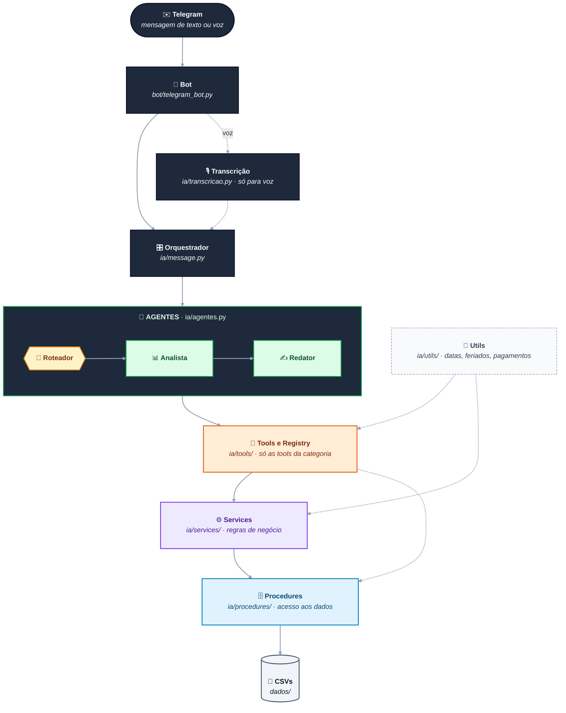
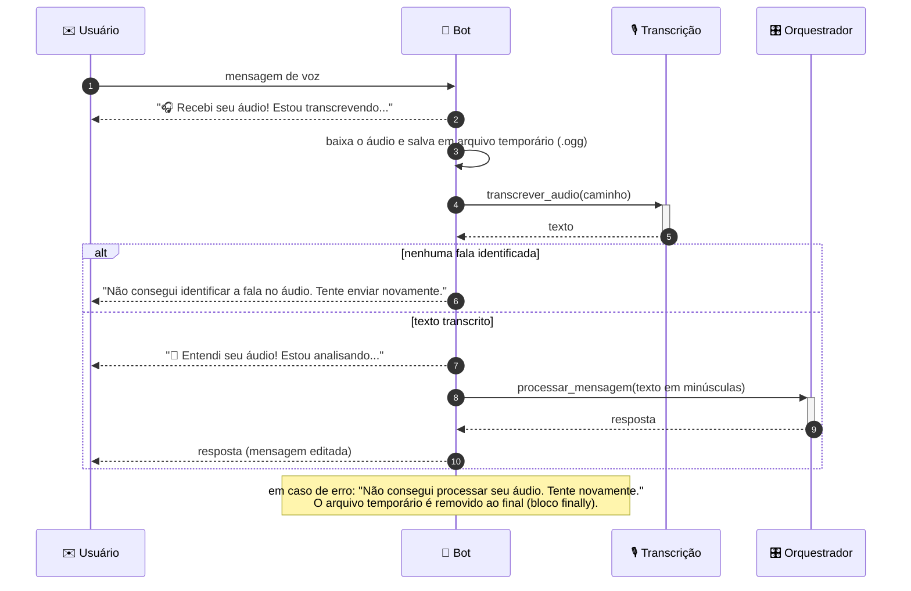
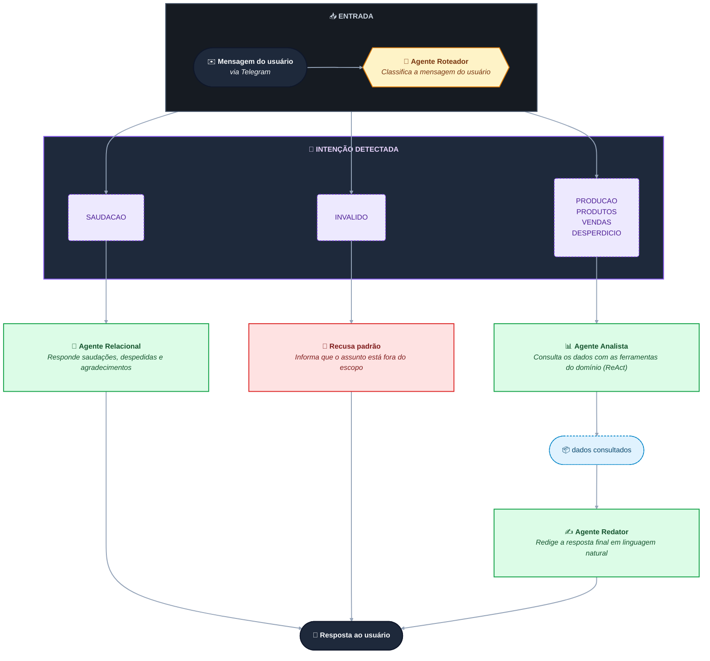
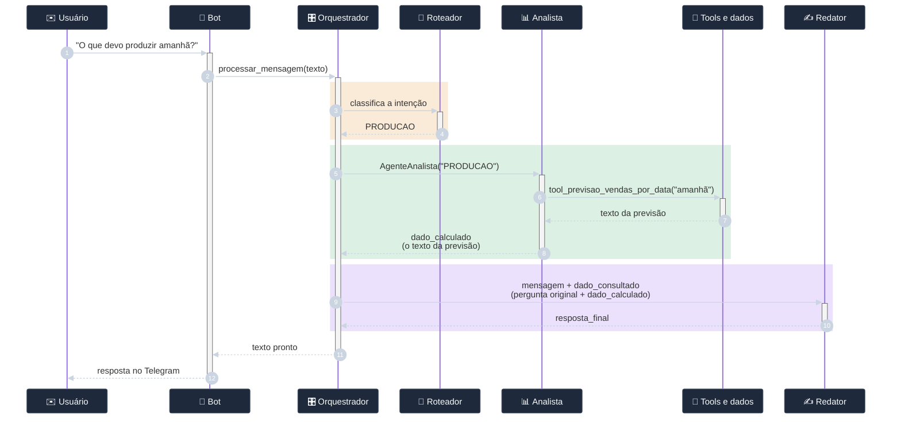

# 🧠 Arquitetura — MIA - Assistente de Análise de Dados

## Sumário
- [Visão geral das camadas](#visao-geral)
- [1. Utilitários (`ia/utils/`)](#utils)
- [2. Motor de Dados: Procedures (`ia/procedures/`)](#procedures)
- [3. Regras de Negócio: Services (`ia/services/`)](#services)
- [4. Ferramentas da IA: Tools e Registry (`ia/tools/`)](#tools)
- [5. Agentes de IA e Fluxo de Mensagens](#agentes)

---

## Visão geral das camadas <a id="visao-geral"></a>

O backend separa estritamente as responsabilidades, com roteamento dinâmico de contexto para otimizar o uso da GPU local:

- **Utils** → funções puras de apoio: datas relativas, períodos do dia, feriados, dias de pagamento e normalização de setor.
- **Procedures** → acesso aos dados, com Pandas (vendas, descartes, produtos, receitas e estoque). Não sabe nada sobre IA.
- **Services** → regras de negócio (ex.: previsão de produção). Combinam procedures e utils.
- **Tools e Registry** → interfaces semânticas categorizadas que a IA consegue chamar. Usam services, procedures e utils.
- **Agentes** → roteamento da intenção, execução ReAct sob demanda e redação da resposta.
- **Bot** → entrada pelo Telegram (texto e mensagens de voz).
- **Transcrição** → converte a mensagem de voz em texto, localmente, antes de a IA processar (`ia/transcricao.py`).



*Linhas pontilhadas: as mensagens de voz passam pela transcrição antes do orquestrador; as tools de `PRODUTOS`, `VENDAS` e `DESPERDICIO` (e a de matéria-prima, em `PRODUCAO`) consultam as procedures diretamente; e os utils dão apoio às tools e aos services.*

### Estrutura de pastas

```text
backend/
├── dados/ ## Banco de dados CSV
│   ├── descarte/                   ## Histórico de quebras mensais
│   ├── regras/                     ## Sazonalidade, clima e feriados (ainda não usado nas respostas)
│   ├── vendas/                     ## Volume histórico de vendas (com o período do dia)
│   ├── backup/                     ## Cópias antigas das planilhas (não são lidas pela aplicação)
│   ├── historico_ingredientes.csv  ## Histórico de preço de custo dos ingredientes
│   ├── historico_produtos.csv
│   ├── ingredientes.csv            ## Estoque atual por ingrediente e setor
│   ├── produtos.csv                ## Catálogo e preços
│   └── receitas.csv                ## Ficha técnica (BOM)
└── src/
    ├── .env                        ## Variáveis (TELEGRAM_BOT_KEY)
    ├── .env.example
    ├── main.py                     ## Ponto de entrada e inicialização
    ├── paths.py                    ## Gestão dinâmica de diretórios
    ├── bot/
    │   └── telegram_bot.py         ## Recepção de mensagens de texto e de voz
    └── ia/
        ├── message.py              ## Orquestrador e roteamento
        ├── agentes.py              ## Signatures e Agentes DSPy
        ├── config.py               ## Setup do Ollama e LLM local
        ├── transcricao.py          ## Transcrição de voz (faster-whisper)
        ├── procedures/             ## Queries diretas ao Pandas (Data Access)
        │   ├── descarte_procedures.py
        │   ├── ingredientes_procedures.py
        │   ├── produtos_procedures.py
        │   ├── regras_procedures.py
        │   └── vendas_procedures.py
        ├── services/               ## Lógica de negócio (Domain)
        │   └── producao_service.py
        ├── tools/                  ## Ferramentas expostas ao Agente
        │   ├── desperdicio_tool.py
        │   ├── producao_tool.py
        │   └── produtos_tools.py
        └── utils/                  ## Funções de apoio
            ├── datas_utils.py
            ├── feriados_utils.py
            ├── pagamentos_utils.py
            └── textos_utils.py
```

---

## 1. Utilitários (`ia/utils/`) <a id="utils"></a>

Funções de apoio, expostas pelo `__init__.py` e usadas assim: `from ia import utils`. São usadas pelas *tools* e pelos *services*.

```python
from ia import utils

utils.converter_data_relativa('segunda passada')
utils.converter_periodo('de manha e a tarde') # ['Manhã', 'Tarde']
utils.normalizar_setor('padaira') # para corrigir o erro ortográfico
```

| Módulo             | Função                                                  | O que faz                                                                                                                                                                                                                                                 |
| ------------------ | ------------------------------------------------------- | --------------------------------------------------------------------------------------------------------------------------------------------------------------------------------------------------------------------------------------------------------- |
| `datas_utils`      | `converter_data_relativa(data_alvo: str) -> str`        | Converte para DD/MM/AAAA: hoje/hj, amanhã, depois de amanhã, ontem, anteontem, "semana passada" e "próxima semana"; contagens ("N dias atrás", "há N dias", "daqui a N dias", "em N dias", inclusive com o número por extenso, como vem da transcrição de voz); dias da semana ("segunda passada", "próxima sexta", "terça retrasada"); datas ISO (AAAA-MM-DD), BR despadronizadas ("2/11/26") e por extenso ("2 de novembro de 2026"). Sem data, assume hoje. Se não reconhecer o texto, devolve o original. |
| `datas_utils`      | `converter_periodo(periodo: str = None) -> list`        | Converte o período dito pelo usuário em uma lista de períodos oficiais (`"Manhã"`, `"Tarde"`, `"Noite"`). Aceita variações com ou sem acento ("de manha", "à noite", "cedo", "vespertino", "noturno", "madrugada" — tratada como Noite) e combinações ("manhã e tarde"). Se vier vazio, "dia todo", "todos os períodos" ou algo não reconhecido, devolve os três períodos. |
| `textos_utils`     | `normalizar_setor(setor_informado: str) -> str \| None` | Corretor ortográfico e mapeador de apelidos de setor (ex: `"cozinha"` → `"Cozinha/Rotisseria"`). Setores oficiais: Açougue, Padaria, Cozinha/Rotisseria, Peixaria e Confeitaria.                                                                          |
| `feriados_utils`   | `eh_feriado(data) -> bool`                              | Verifica feriados fixos (nacionais, SP e municipais) e móveis (Carnaval, Sexta-Feira Santa e Corpus Christi, calculados a partir da Páscoa). O 20/11 só conta a partir de 2024.                                                                           |
| `pagamentos_utils` | `dias_ate_pagamento(valor: str) -> int`                 | Calcula a distância até o pagamento (dia 20, antecipado para o dia 19 se cair no domingo, ou 5º dia útil; sábado é útil e feriado não). `0` é o próprio dia, negativo é pagamento no futuro, positivo é no passado, e `-999` é sem pagamento em ±20 dias. |
| `pagamentos_utils` | `classificar_dia(data: str) -> int`                     | Devolve `1` (dia de pico) ou `0` (dia comum). É pico se for dia de pagamento, sexta a domingo ou feriado. Resultado em cache (`lru_cache`).                                                                                                               |

---

## 2. Motor de Dados: Procedures (`ia/procedures/`) <a id="procedures"></a>

Todo acesso é feito através do `__init__.py`, que expõe cada arquivo como um "apelido":

```python
from ia import procedures

procedures.vendas.buscar_por_nome_produto("coxinha")
procedures.produtos.buscar_por_setor("Padaria")
```

A maior parte dos CSVs (produtos, vendas, descartes, receitas e estoque) é lida ao importar o módulo e fica em memória, então alterações nos arquivos só valem após reiniciar o bot. As exceções são `buscar_ingredientes`, que relê `receitas.csv` a cada chamada, e a tool de desperdício, que lê `produtos.csv` e `historico_ingredientes.csv` a cada consulta.

| Apelido        | Arquivo                      | Fonte de dados                  | O que oferece                                                                                                                                                                                                                 |
| -------------- | ---------------------------- | ------------------------------- | ----------------------------------------------------------------------------------------------------------------------------------------------------------------------------------------------------------------------------- |
| `produtos`     | `produtos_procedures.py`     | `dados/produtos.csv`            | Catálogo: `listar`, `listar_detalhado`, `buscar_por_nome`, `buscar_por_setor` (com fallback que separa o setor em partes), `buscar_por_tempo`, `obter_dicionario_sku_nome`, `nome_do_sku`, `nome_para_skus`, `setor_do_sku`, `skus_por_nome`, `skus_por_setor`, `produtos_por_setor` e `valores_por_produtos` (preço de cada produto de uma lista). |
| `vendas`       | `vendas_procedures.py`       | `dados/vendas/vendas_*.csv`     | `todas_as_vendas`, `buscar_por_data`, `buscar_por_periodo`, `buscar_por_nome_produto`, `produtos_mais_vendidos`.                                                                                                              |
| `descarte`     | `descarte_procedures.py`     | `dados/descarte/descarte_*.csv` | Consultas e somas de desperdício: por produto, por data, por produto e dia, total, média diária, top 5, maior/menor dia, produtos acima de um limite e `buscar_por_intervalo` (registros entre duas datas).                                                                        |
| `regras`       | `regras_procedures.py`       | `dados/regras/regras_*.csv`     | Calendário de regras (clima, feriado, véspera, fim de semana, dia útil): `obter_dia`, `obter_mes`, `obter_semana`, `obter_ano` e `filtrar`.                                                                                   |
| `ingredientes` | `ingredientes_procedures.py` | `dados/receitas.csv` e `dados/ingredientes.csv` | Receitas e estoque: `buscar_receita_por_sku`, `buscar_ingredientes` (ingredientes e quantidades de um SKU), `consultar_estoque_por_ingrediente` (estoque de um ingrediente, com filtro opcional por setor) e `formatacao_pre_calculo` (une receita e estoque de uma lista de SKUs e devolve, para cada ingrediente, o SKU, a quantidade na receita e a quantidade em estoque no setor do produto, para o cálculo de matéria-prima). |

---

## 3. Regras de Negócio: Services (`ia/services/`) <a id="services"></a>

Camada entre as *tools* e as *procedures*: cruza dados de várias procedures e aplica as regras de negócio. Uso: `from ia import services`.

```python
from ia import services

services.producao.dataframe_vendas_similares('10/10/2026')
services.producao.calcular_producao_data('10/10/2026', 'padaria')
```

### Produção (`producao_service.py`) → `services.producao`

| Função                                                          | O que faz                                                                                                                                                                                 |
| --------------------------------------------------------------- | ----------------------------------------------------------------------------------------------------------------------------------------------------------------------------------------- |
| `dataframe_vendas_similares(data: str) -> DataFrame`            | Busca as vendas de dias passados com o mesmo perfil (pico ou comum) da data alvo, usando `utils.classificar_dia`.                                                                         |
| `dataframe_vendas_por_periodo(data: str, periodo: str) -> DataFrame` | Igual ao anterior, mas filtrado por **um** período do dia (`Manhã`, `Tarde` ou `Noite`), usando a coluna `Período` das vendas. |
| `media_vendas_produtos(vendas_similares, setor=None) -> list`   | Calcula a média diária de saída por produto e aplica a **margem de produção de +5%** (arredondada para cima). Filtra por setor, se informado. Devolve strings no formato `"Produto: N"`. |
| `calcular_producao_data(data: str, setor=None) -> dict \| None` | Cruza vendas e descartes pelo SKU: **produção real = vendas + descarte**. Devolve `None` se o setor não tem produtos e só inclui itens com produção maior que zero.                       |

---

## 4. Ferramentas da IA: Tools e Registry (`ia/tools/`) <a id="tools"></a>

A arquitetura utiliza o padrão *Facade/Registry* no `__init__.py` para isolar o contexto do LLM. As ferramentas são decoradas com suas categorias, permitindo que o Agente carregue apenas o estritamente necessário.

### O Decorador Dinâmico (`__init__.py`)
Fornece o decorador `@dspy_tool('CATEGORIA')`, o dicionário `REGISTRO_DE_FERRAMENTAS` e a função `obter_ferramentas_por_categoria()`. Os módulos de tools são importados no fim do `__init__.py`, para que os decoradores rodem na inicialização.

### Produção & Previsão (`producao_tool.py`) - Categoria: `PRODUCAO`

Usam `services.producao`, `procedures` e `utils`. Antes de calcular, tratam a data (relativa → real) e o setor (normalizado) com o auxiliar `_tratar_parametros_iniciais`, e, nas tools de previsão e de meta, formatam a lista conforme `tipo_pergunta` (`"quais"` devolve só os nomes, `"quanto"` devolve as quantidades).

| Tool                            | Assinatura                                                                    | Foco                                                        |
| ------------------------------- | ----------------------------------------------------------------------------- | ----------------------------------------------------------- |
| `tool_previsao_vendas_por_data` | `(data: str = "hoje", setor: str = "", tipo_pergunta: str = "quanto") -> str` | O que *deve* ser produzido (média de dias similares + 5%). |
| `tool_meta_producao_passada`    | `(data: str = "hoje", setor: str = "", tipo_pergunta: str = "quanto") -> str` | O que *deveria* ter sido produzido.                         |
| `tool_producao_por_data`        | `(data: str, setor: str = "") -> str`                                         | O que *efetivamente* foi produzido (vendas + descartes).    |
| `tool_previsao_vendas_por_periodo` | `(periodo: str, data: str = "hoje", setor: str = "") -> str` | Previsão de produção **por período do dia** (manhã, tarde, noite). |
| `tool_previsao_quantidade_mp`   | `(data = "hoje", setor = "")`                                                 | Matéria-prima a separar para a produção prevista (receita × previsão, comparada ao estoque do setor). |

**Previsão por período (`tool_previsao_vendas_por_periodo`).** Só é acionada quando o usuário cita um período do dia; perguntas apenas com data ou setor continuam usando `tool_previsao_vendas_por_data`. O período dito é convertido por `utils.converter_periodo`, e a média de cada período é calculada com `services.producao.dataframe_vendas_por_periodo` + `media_vendas_produtos`. A saída depende da quantidade de períodos pedidos:

```text
# um período (ex.: "de manhã")         # vários períodos ou o dia todo (valores ilustrativos)
- Pão Francês (Kg): 10                * Pão Francês (Kg)
                                         - manhã: 10
                                         - tarde: 6
                                         - noite: 3
```

**Matéria-prima (`tool_previsao_quantidade_mp`).** Calcula a previsão do dia (mesma base de `tool_previsao_vendas_por_data`), busca a receita de cada produto e o estoque do ingrediente no setor do produto (`procedures.ingredientes.formatacao_pre_calculo`) e lista, para cada produto e ingrediente, a quantidade necessária (previsão × quantidade na receita) e a sobra em estoque. Quando o estoque não cobre a necessidade, o item é marcado como insuficiente, com o necessário e o disponível. As quantidades são exibidas em `unidades`. Exemplo de saída:

```text
Matéria-prima necessária para amanhã (26/10/2026):

- Pão Francês (Kg): Farinha de Trigo - 87.10 unidades (Sobra: 120.00 unidades)
- Lasanha (Kg): quantidade insuficiente em estoque (Necessário: 5.40 unidades, Estoque: 3.00 unidades)
```
(valores ilustrativos)

### Catálogo de Produtos (`produtos_tools.py`) - Categorias: `PRODUTOS` e `VENDAS`

Chamam `procedures.produtos` diretamente.

**Categoria `PRODUTOS`**

| Tool                             | Assinatura            | Foco                                                  |
| -------------------------------- | --------------------- | ----------------------------------------------------- |
| `listar_todos_produtos`          | `() -> str`           | Catálogo completo de produtos.                        |
| `listar_detalhes_todos_produtos` | `() -> str`           | Catálogo completo com Nome, Setor e Tempo de preparo. |
| `informacoes_produto`            | `(nome: str) -> str`  | Detalhes de um produto específico.                    |
| `informacoes_produto_setor`      | `(setor: str) -> str` | Detalhes dos produtos de um setor.                    |
| `produto_por_tempo_preparo`      | `(tempo: str) -> str` | Produtos que levam um tempo específico de preparo.    |

**Categoria `VENDAS`**

| Tool                  | Assinatura                    | Foco                                                              |
| --------------------- | ----------------------------- | ----------------------------------------------------------------- |
| `produtos_do_setor`   | `(setor: str = "") -> str`    | Produtos (com preço) de um setor; sem setor, lista todos.         |
| `valores_dos_produtos` | `(produtos: str) -> str`      | Preço de cada produto de uma lista (separada por vírgula ou linha). |

### Desperdício (`desperdicio_tool.py`) - Categoria: `DESPERDICIO`

| Tool                     | Assinatura                                                              | Foco                                                              |
| ------------------------ | ----------------------------------------------------------------------- | ----------------------------------------------------------------- |
| `tool_buscar_por_intervalo` | `(data_inicio: str = "hoje", data_fim: str = "", setor: str = "") -> str` | Custo total (R$) do desperdício em uma data ou em um intervalo, com filtro opcional por setor. |

Trata data e setor com o mesmo `_tratar_parametros_iniciais` das tools de produção. Se `data_fim` não for informada, a consulta vale só para `data_inicio`. A tool consulta `produtos.csv` (setor de cada SKU) e `historico_ingredientes.csv` (preços de custo) diretamente. O custo é calculado, e não estimado:

1. `procedures.descarte.buscar_por_intervalo` traz os descartes do período (e, se houver setor, filtra os SKUs pelo setor em `produtos.csv`).
2. Os descartes são somados por data e SKU.
3. Para cada um, `procedures.ingredientes.buscar_ingredientes` traz a receita, e o preço de custo de cada ingrediente é o último registro de `historico_ingredientes.csv` com data menor ou igual à do descarte.
4. Custo = Σ (quantidade do ingrediente na receita × preço de custo) × quantidade descartada. Se faltar preço histórico de algum ingrediente, a tool devolve um erro em vez de um valor parcial.
---

## 5. Agentes de IA e Fluxo de Mensagens <a id="agentes"></a>

### 5.1. Inicialização e Recepção de Mensagens

**Inicialização (`main.py`)**, nesta ordem:
1. Carrega o `src/.env` e exige `TELEGRAM_BOT_KEY` (sem ela, o programa não sobe). Desabilita o IPv6 para acelerar a resposta do bot.
2. Verifica se o Ollama está online em `localhost:11434` (se não estiver, encerra).
3. Configura o DSPy com o modelo de `ia/config.py` (`ollama/gemma4:e2b`, `max_tokens=4096`, `num_ctx=8192`, `reasoning_effort="None"`).
4. Aquece o modelo na GPU com uma chamada de teste.
5. Inicia o bot em *polling*.

**Recepção (`bot/telegram_bot.py`)**: o bot atende **texto** e **mensagens de voz** (gravadas no próprio Telegram).
- `/start` envia a mensagem de boas-vindas da MIA.
- **Texto:** cada mensagem gera uma mensagem temporária "⏳ Processando sua solicitação...", que depois é editada com a resposta final. O texto vai para a IA em minúsculas.
- **Voz:** o fluxo é o descrito abaixo e termina no mesmo `processar_mensagem()` do texto.
- Qualquer outro formato (arquivo de áudio, foto, vídeo, vídeo-nota, documento, figurinha, GIF, localização e contato) recebe um aviso pedindo que a pessoa envie apenas mensagens de texto ou de voz.

**Transcrição de voz (`ia/transcricao.py`)**: usa o `faster-whisper` (modelo `small`, executado na CPU com `compute_type="int8"`, idioma `pt` e filtro de silêncio VAD). O modelo é carregado quando o módulo é importado, ou seja, na inicialização do bot, e é baixado automaticamente na primeira execução.



### 5.2. Roteamento de Agentes (`ia/agentes.py` e `ia/message.py`)

Em vez de um agente monolítico, o sistema roteia a mensagem e cria o Agente Analista "sob demanda", para economizar contexto na placa de vídeo. O orquestrador `processar_mensagem()` (`ia/message.py`) executa o fluxo abaixo.



| Agente                | Código                                    | Tipo DSPy              | O que faz                                                                                                                                                                                                       |
| --------------------- | ----------------------------------------- | ---------------------- | --------------------------------------------------------------------------------------------------------------------------------------------------------------------------------------------------------------- |
| **Agente Roteador**   | `agente_roteador` · `RotearIntencao`      | `dspy.Predict`         | Categoriza estritamente em rótulos conhecidos (`SAUDACAO`, `PRODUCAO`, `PRODUTOS`, `VENDAS`, `DESPERDICIO`, `INVALIDO`).                                                                                                       |
| **Agente Relacional** | `agente_relacional` · `ResponderSaudacao` | `dspy.Predict`         | Responde saudações, despedidas e agradecimentos de forma curta, simpática e natural, sempre assumindo a identidade da MIA. A um oi ou olá, pergunta como pode ajudar na produção do supermercado. |
| **Agente Analista**   | `AgenteAnalista`                          | `dspy.Module` dinâmico | Instancia um `dspy.ReAct` (`ciclo_react`) recebendo como parâmetro de inicialização a categoria escolhida, carregando **exclusivamente** as ferramentas pertinentes a esse assunto. Devolve o `dado_calculado`. |
| **Agente Redator**    | `agente_redator` · `RedigirResposta`      | `dspy.Predict`         | Recebe a `mensagem` do usuário e o `dado_consultado` e os transforma em texto natural, em português do Brasil, aplicando regras de UX (sem saudações iniciais, uso de bullets `•`, preços no formato R$ X,XX e nenhum número resumido ou omitido). |
| **Recusa padrão**     | `processar_mensagem` (`ia/message.py`)    | — (texto fixo)         | Responde que o assunto está fora do escopo quando a categoria é `INVALIDO`. Não aciona o LLM.                                                                                                                   |

**Tratamento de erros** (`ia/message.py`): se o DSPy não conseguir interpretar a saída do modelo (`AdapterParseError`), a pessoa recebe um aviso de que a IA não conseguiu processar as ferramentas. Qualquer outro erro devolve um aviso genérico de falha de conexão com a IA.

### 5.3. Fluxo de vida da mensagem — Exemplo prático

