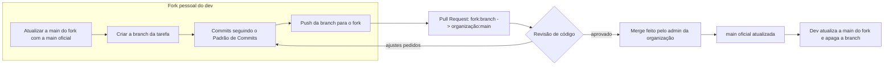

# Estratégia de Branch

## Contexto e motivação

Este é um projeto de 1º semestre de ADS, e a experiência da equipe com Git como um todo ainda é baixa — é normal que a maioria esteja aprendendo a usar branches, resolver conflitos e abrir Pull Requests pela primeira vez ao longo do próprio projeto. Um modelo com múltiplas branches de feature e permissões de push distribuídas entre todo o time dentro do repositório oficial aumentaria bastante o risco de conflitos mal resolvidos e de alterações acidentais quebrando a `main` compartilhada.

Por isso, o modelo adotado concentra o merge em uma única pessoa e faz cada membro trabalhar isolado no próprio fork, **sempre em uma branch criada para a tarefa**, até a mudança estar pronta e revisada. Isso funciona como uma rede de segurança: ninguém corre o risco de derrubar o projeto dos outros enquanto ainda está aprendendo o fluxo, e toda mudança passa por revisão antes de tocar na `main` oficial.

Trabalhar em branches (e não direto na `main` do fork) traz quatro vantagens:

- A `main` do fork fica sempre igual à `main` oficial, servindo de ponto de partida limpo para cada nova tarefa.
- Cada pessoa pode ter mais de uma tarefa em andamento sem misturar as alterações.
- Cada Pull Request fica restrito a uma única tarefa, o que facilita a revisão.
- Se a revisão pedir ajustes, basta enviar novos commits para a mesma branch: o PR se atualiza sozinho.

## Como configurar a organização no GitHub

- Apenas **uma pessoa** deve ter permissão de administrador/push direto na organização (o merge da `main` oficial passa só por ela).
- Nenhum outro membro deve ter permissão de escrita direta no repositório da organização.
- O repositório oficial tem somente a `main`. Não crie branches de trabalho (`feat/`, `fix/` etc.) dentro dele: elas nascem nos **forks pessoais**.

## Nome das branches

O nome da branch segue o mesmo padrão dos commits: o **tipo** da alteração (veja [Padrão de Commits](./Padrões%20de%20Commits.md)), o **código da tarefa no Jira** e uma descrição curta.

```
<tipo>/MT-XX-descricao-curta
```

| Regra                                       | Exemplo                                          |
| :------------------------------------------ | :----------------------------------------------- |
| Tipos: `feat`, `fix`, `docs`, `refactor`, `style`, `test` e `chore` | `feat/MT-121-media-de-vendas`    |
| Uma branch para cada tarefa do Jira         | `fix/MT-45-calculo-da-media`                     |
| Letras minúsculas, sem acentos, palavras separadas por hífen | `docs/MT-12-cronograma-no-readme` |
| Descrição curta, que diga o que a branch faz | `refactor/MT-88-inicializacao-da-api`           |

## Fluxo de trabalho (o que cada dev deve fazer)

**Configuração inicial (uma vez só):**

1. **Fork:** faça um fork pessoal do repositório oficial da organização na sua própria conta do GitHub.
2. **Clone local:** clone o seu próprio fork (não o repositório da organização) para a sua máquina.
3. **Remote oficial:** adicione o repositório oficial como `upstream`, para poder buscar as novidades da `main` oficial.

**A cada tarefa:**

4. **Atualizar a `main`:** antes de começar, traga a `main` oficial para o seu fork (comandos abaixo).
5. **Criar a branch:** crie a branch da tarefa a partir da `main` atualizada, seguindo o nome definido acima.
6. **Alterações e commits:** faça as alterações localmente, na branch da tarefa, e commite seguindo o [Padrão de Commits](./Padrões%20de%20Commits.md). Nunca commite direto na `main`.
7. **Push:** suba a branch da tarefa para o seu fork.
8. **Pull Request:** abra um PR da branch do seu fork (`<seu-usuario>/api-1-semestre-2026:<tipo>/MT-XX-descricao-curta`) para a `main` do repositório oficial da organização. O título do PR segue o Padrão de Commits.
9. **Revisão de código:** aguarde a revisão dos responsáveis definidos abaixo. Se pedirem ajustes, faça novos commits na mesma branch e envie de novo.
10. **Aprovação e merge:** somente a pessoa definida como administradora da organização aprova e realiza o merge na `main` oficial.
11. **Limpeza:** depois do merge, atualize a `main` do fork e apague a branch da tarefa (local e no fork).



### Comandos de referência

```bash
# configuração inicial (uma vez)
git clone https://github.com/<seu-usuario>/api-1-semestre-2026.git
git remote add upstream https://github.com/<organizacao>/api-1-semestre-2026.git

# a cada tarefa: atualizar a main do fork e criar a branch
git switch main
git fetch upstream
git merge --ff-only upstream/main
git push origin main
git switch -c feat/MT-121-media-de-vendas

# durante a tarefa
git add .
git commit -m "feat (MT-121): Adiciona função para calcular a média de vendas"
git push -u origin feat/MT-121-media-de-vendas

# se a main oficial andou enquanto você trabalhava (resolva os conflitos aqui, antes do PR)
git fetch upstream
git merge upstream/main

# depois do merge do PR
git switch main
git fetch upstream
git merge --ff-only upstream/main
git push origin main
git branch -d feat/MT-121-media-de-vendas
git push origin --delete feat/MT-121-media-de-vendas
```

## Papéis e responsabilidades

| Papel                             | Responsável                                                     | O que faz                                                                                 |
| :-------------------------------- | :-------------------------------------------------------------- | :---------------------------------------------------------------------------------------- |
| **Merge / aprovação final do PR** | Felipe Morais (Scrum Master)                                    | Único membro com permissão de push/merge na `main` oficial da organização                 |
| **Revisão de código**             | Henrique de Castro (Product Owner) e Marcus Vinícius (Dev Team) | Revisam o PR antes de ele ser aprovado — qualidade técnica e aderência à regra de negócio |
| **Autoria das alterações**        | Todos os membros da Dev Team                                    | Trabalham em branches nos seus próprios forks pessoais e abrem os PRs                     |
| **Versão da entrega da Sprint**   | Felipe Morais (Scrum Master)                                    | Cria a tag de versão na `main` oficial depois do merge do último PR da Sprint             |

## Entrega da Sprint (versão)

Depois que o último PR da Sprint é aprovado e mergeado, o administrador da organização cria uma tag anotada na `main` oficial, com o número da Sprint: `v1.0.0` para a Sprint 1, `v2.0.0` para a Sprint 2, `v3.0.0` para a Sprint 3, e assim por diante.

```bash
git tag -a v3.0.0 -m "Versão 3.0.0 - entrega da Sprint 3"
git push origin v3.0.0
```

## Boas práticas para manter esse modelo funcionando

- Mantenha a `main` do seu fork sempre igual à `main` oficial e atualize-a antes de criar cada branch nova, para reduzir conflitos no PR.
- Faça uma branch por tarefa do Jira e mantenha-a curta: quanto menor o PR, mais rápida e segura é a revisão.
- Não misture tarefas diferentes na mesma branch.
- Escreva títulos de PR e mensagens de commit descritivos, seguindo o Padrão de Commits — o nome da branch e o **histórico de Pull Requests** do repositório oficial são o principal registro de "o que foi feito e quando".
- Peça revisão sempre que tiver dúvida, mesmo em mudanças pequenas — é melhor perguntar antes do merge do que corrigir depois na `main` compartilhada.
- Em caso de conflito, resolva-o na sua branch (com `git merge upstream/main`) antes de pedir a revisão, e peça ajuda se tiver dúvida.
