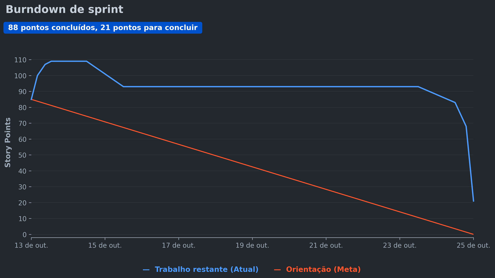

# Documentação - Sprint 2

  <!-- Imagem que aparece apenas no Modo Escuro -->
  
  
  <!-- Imagem que aparece apenas no Modo Claro -->
  
  
  <h3>MIA - Assistente de Análise de Dados</h3>

 

  <a href ="#desafio"> Desafio</a> &nbsp;&bull;&nbsp;
  <a href ="#us"> User Stories</a> &nbsp;&bull;&nbsp;  
  <a href ="#dor">DoR</a> &nbsp;&bull;&nbsp;
  <a href ="#dod">DoD</a> &nbsp;&bull;&nbsp;
  <a href ="#burndown"> Burndown</a> &nbsp;&bull;&nbsp;
  <a href ="#equipe"> Equipe</a>

---

> [!IMPORTANT]
> **Status do Projeto:**  Concluído ✅

## 🏅 Desafio 

Evoluir a MIA além do planejamento de produção, levando ao líder e ao gerente uma visão financeira e operacional dos setores, sempre por linguagem natural no Telegram. O desafio central é traduzir as perdas em valor financeiro (cruzando os descartes com o custo unitário dos produtos), recortar a previsão de produção por período do dia, estimar a matéria-prima necessária para o dia seguinte e apoiar as transferências entre setores. Soma-se a isso uma nova forma de interação: o envio de perguntas por áudio, com transcrição feita localmente. Toda a inteligência e o processamento continuam operando de forma autônoma, sem persistência de dados e sem APIs externas de terceiros.

## 📋 User Stories 

| $\textsf{\textbf{Capacidade estimada da Equipe por Sprint:}}$                         | $\textsf{85 Story Points (\textbf{64 SP entregues} \color{#808080}{/ 21 SP não entregues})}$ |
| ------------------------------------------------------------------------------------- | -------------------------------------------------------------------------------------------- |
| $\color{#2e8b57}{\textsf{\textbf{Meta da Sprint:}}}$                                  | $\textsf{User Stories de rank 5, 6, 7 e 8 (\textit{39 Story Points — 100\% entregue})}$      |
| $\textsf{\textbf{Previsão da Sprint} (\textit{extras, sem compromisso de entrega}):}$ | $\textsf{User Stories de rank 9 e 10 entregues (\textit{25 SP}) \color{#808080}{/ rank 11 e 12 não entregues (\textit{21 SP})}}$ |

|                  Rank                  |                 Prioridade                 | User Story                                                                                                                                                                                                          |              Story Points               |                 Sprint                 |                 Status                 |
| :------------------------------------: | :----------------------------------------: | ------------------------------------------------------------------------------------------------------------------------------------------------------------------------------------------------------------------- | :-------------------------------------: | :------------------------------------: | :------------------------------------: |
| $\color{#2e8b57}{\textsf{\textbf{5}}}$ | $\color{#2e8b57}{\textsf{\textbf{Média}}}$ | $\color{#2e8b57}{\textsf{\textbf{Eu, como líder, quero saber quais produtos devo produzir em cada período do dia, a fim de otimizar o tempo dos colaboradores.}}}$                                                  | $\color{#2e8b57}{\textsf{\textbf{13}}}$ | $\color{#2e8b57}{\textsf{\textbf{2}}}$ | $\color{#2e8b57}{\textsf{\textbf{✅}}}$ |
| $\color{#2e8b57}{\textsf{\textbf{6}}}$ | $\color{#2e8b57}{\textsf{\textbf{Média}}}$ | $\color{#2e8b57}{\textsf{\textbf{Eu, como gerente, quero saber quantos reais foram descartados em cada setor, a fim de monitorar o impacto financeiro das perdas dos setores.}}}$                                   | $\color{#2e8b57}{\textsf{\textbf{8}}}$  | $\color{#2e8b57}{\textsf{\textbf{2}}}$ | $\color{#2e8b57}{\textsf{\textbf{✅}}}$ |
| $\color{#2e8b57}{\textsf{\textbf{7}}}$ | $\color{#2e8b57}{\textsf{\textbf{Média}}}$ | $\color{#2e8b57}{\textsf{\textbf{Eu, como gerente, quero saber quantos reais foram descartados, a fim de avaliar o custo global de desperdício da empresa.}}}$                                                      | $\color{#2e8b57}{\textsf{\textbf{5}}}$  | $\color{#2e8b57}{\textsf{\textbf{2}}}$ | $\color{#2e8b57}{\textsf{\textbf{✅}}}$ |
| $\color{#2e8b57}{\textsf{\textbf{8}}}$ | $\color{#2e8b57}{\textsf{\textbf{Baixa}}}$ | $\color{#2e8b57}{\textsf{\textbf{Eu, como gerente, quero saber quais produtos me trazem mais lucro, a fim de orientar estrategicamente os setores.}}}$                                                              | $\color{#2e8b57}{\textsf{\textbf{13}}}$ | $\color{#2e8b57}{\textsf{\textbf{2}}}$ | $\color{#2e8b57}{\textsf{\textbf{✅}}}$ |
|              $\textsf{9}$              |              $\textsf{Baixa}$              | $\textsf{Eu, como gestor, quero interagir com o assistente de análise de dados enviando perguntas por áudio, a fim de obter insights das planilhas de forma fluida e sem contato manual (semelhante a uma Alexa).}$ |              $\textsf{10}$              |              $\textsf{2}$              |                   ✅                    |
|             $\textsf{10}$              |              $\textsf{Baixa}$              | $\textsf{Eu, como líder, quero saber quanta matéria-prima eu preciso deixar preparada para o dia seguinte, a fim de otimizar o tempo e reduzir o desperdício de matéria-prima.}$                                    |              $\textsf{15}$              |              $\textsf{2}$              |                   ✅                    |
|     $\color{#808080}{\textsf{11}}$     |     $\color{#808080}{\textsf{Baixa}}$      | $\color{#808080}{\textsf{Eu, como líder, quero saber quais matérias-primas estão disponíveis para transferir a outros setores, a fim de reaproveitar recursos parados e evitar compras desnecessárias.}}$           |     $\color{#808080}{\textsf{13}}$      |     $\color{#808080}{\textsf{2}}$      |     $\color{#808080}{\textsf{❌}}$      |
|     $\color{#808080}{\textsf{12}}$     |     $\color{#808080}{\textsf{Baixa}}$      | $\color{#808080}{\textsf{Eu, como gerente, quero saber por que o produto X está sendo transferido de setor, a fim de identificar falhas no planejamento original da produção.}}$                                    |      $\color{#808080}{\textsf{8}}$      |     $\color{#808080}{\textsf{2}}$      |     $\color{#808080}{\textsf{❌}}$      |

> [!NOTE]
> A Sprint 2 reúne as histórias da Sprint 2 e da Sprint 3. As User Stories de **rank 5 a 8** são a meta da Sprint; as de **rank 9 a 12** são o que vamos tentar entregar, sem compromisso de entrega. Em relação ao backlog anterior, a **US05** passou a tratar do que produzir em cada período do dia (antes era lucro) e a **US06** passou a ser do gerente e a mostrar o valor descartado de cada setor. As **US07** e **US08** não foram alteradas.

---

## 🏅 DoR - Definition of Ready 

A avaliação detalhada de DoR e DoD, User Story por User Story, está em [`Checklist - Sprint 2`](./Checklist%20-%20Sprint%202.md). Os cenários de aceitação estão no [`BDD - Sprint 2`](./testes/BDD%20-%20Sprint%202.md).

| Critério                      | Descrição                                                                                                                                                                                                   |
| :---------------------------- | :---------------------------------------------------------------------------------------------------------------------------------------------------------------------------------------------------------- |
| **Clareza na Descrição**      | A User Story está escrita no formato: "Eu, como [papel], quero [ação], a fim de [objetivo/valor]".                                                                                                          |
| **Critérios de Aceitação**    | A história possui critérios claros e pelo menos um cenário de teste básico (BDD) mapeado (Dado que... Quando... Então...).                                                                                  |
| **Independente**              | A história pode ser desenvolvida sem depender de tarefas bloqueantes dentro da mesma Sprint. Quando houver dependência (ex.: a US11 depende da US10), ela está identificada.                                |
| **Compreensão Compartilhada** | A equipe entende o propósito e estimou o esforço da tarefa (Story Points definidos).                                                                                                                        |
| **Mapeamento de Intenções**   | Estão documentados exemplos reais de frases em linguagem natural que o usuário pode enviar (ex: "o que produzo de manhã?", "quantos reais perdemos ontem?").                                                |
| **Dados Disponíveis**         | Está definido qual arquivo e coluna dos CSVs estáticos serão lidos, e os dados que ainda não existem na base (ex.: horário das vendas, custo unitário, matéria-prima, transferências) têm origem combinada. |
| **Critérios Técnicos**        | Está definido o que o modelo via **DSPy** precisará extrair da frase (parâmetros) e qual regra o **Pandas** deverá aplicar.                                                                                 |

## 🏅 DoD - Definition of Done 

| Critério                         | Descrição                                                                                                                                                                       |
| :------------------------------- | :------------------------------------------------------------------------------------------------------------------------------------------------------------------------------ |
| **Critérios Atendidos**          | Todos os critérios de aceitação e cenários de teste da User Story foram cumpridos e validados com sucesso.                                                                      |
| **Interpretação Validada (NLP)** | A IA interpretou corretamente diferentes variações da mesma pergunta, em texto ou em áudio, acionando a regra correta.                                                          |
| **Código Revisado**              | O código passou por Code Review (Pull Request revisado e aprovado por pelo menos um outro membro da equipe).                                                                    |
| **Testes Registrados**           | Os casos do Guia de Testes foram executados e registrados no Relatório de Testes, sem falhas pendentes.                                                                         |
| **Documentação Atualizada**      | As novas capacidades do bot e os mapeamentos dos CSVs estáticos foram atualizados na documentação.                                                                              |
| **Integração Validada**          | A nova capacidade de resposta não confunde a IA em relação a outras perguntas já suportadas (inclusive as das sprints anteriores) e o bot lida bem com frases fora de contexto. |
| **Validação do PO**              | O Product Owner conversou de forma natural com o bot no Telegram e confirmou que o retorno atende à regra de negócio.                                                           |
| **Pronto para Deploy**           | O código está limpo, mergeado na branch principal e pronto para ser executado.                                                                                                  |

## 🏅 Sprint Burndown 

  

 

## 🎓 Equipe 

  <table>
    <tr>
      <td align="center">
         
        <b>Henrique de Castro</b> 
        Product Owner 
         
      </td>
      <td align="center">
         
        <b>Felipe Morais</b> 
        Scrum Master 
         
      </td>
    </tr>
  </table>
  <table>
    <tr>
      <td align="center">
         
        <b>Mirela Cristina</b> 
        Dev Team 
         
      </td>
      <td align="center">
         
        <b>Eduardo Granja</b> 
        Dev Team 
         
      </td>
      <td align="center">
         
        <b>Ian Victor</b> 
        Dev Team 
         
      </td>
      <td align="center">
         
        <b>Marcus Vinícius</b> 
        Dev Team 
         
      </td>
    </tr>
  </table>
  <table>
    <tr>
      <td align="center">
         
        <b>Leandro Silva</b> 
        Dev Team 
         
      </td>
      <td align="center">
         
        <b>Adham Goulart</b> 
        Dev Team 
         
      </td>
      <td align="center">
         
        <b>Matheus Correia</b> 
        Dev Team 
         
      </td>
    </tr>
  </table>

---

# 🎓 Contexto acadêmico

A **MIA**, desenvolvida pela **McLorem Tecnologia**, faz parte da **Aprendizagem por Projetos Integrados (API)** do 1º semestre do curso de **Análise e Desenvolvimento de Sistemas da Fatec São José dos Campos**.

 

### MIA - Assistente de Análise de Dados

**McLorem Tecnologia · Fatec São José dos Campos · 2026**

